# LandGuard – Land Verification & Intelligence Platform
## Document 03: Entity Relationship Diagram & Data Dictionary

---

### 1. High-Level Entity Relationship Diagram (ERD)

```mermaid
erDiagram
    users ||--o{ user_roles : has
    roles ||--o{ user_roles : assigned_to
    roles ||--o{ role_permissions : grants
    permissions ||--o{ role_permissions : mapped_to

    villages ||--o{ properties : contains
    properties ||--|| property_boundaries : defines_geometry
    properties ||--o{ khasra_records : cataloged_as
    properties ||--o{ ownership_records : holds_title
    properties ||--o{ ownership_history : past_conveyances
    properties ||--o{ government_land_records : public_tenure
    properties ||--o{ legal_disputes : litigated_in
    legal_disputes ||--o{ court_cases : tracks_cases
    properties ||--o{ encumbrance_records : pledged_with
    properties ||--o{ property_documents : backed_by
    properties ||--o{ property_change_requests : pending_edits
    
    property_sources ||--o{ ownership_records : cites_source
    property_sources ||--o{ government_land_records : cites_source
    property_sources ||--o{ legal_disputes : cites_source
    property_sources ||--o{ encumbrance_records : cites_source
    
    users ||--|| token_wallets : owns
    token_wallets ||--o{ token_transactions : debits_credits
    users ||--o{ payments : initiates
    token_packages ||--o{ payments : selects_package
    users ||--o{ report_access : unlocks
    properties ||--o{ report_access : report_of
    
    users ||--o{ user_reports : submits_complaint
    users ||--o{ admin_activity_logs : performed_by

    users {
        uuid id PK
        string email UK
        string password_hash
        string full_name
        string phone_number
        boolean is_active
        boolean is_verified
        timestamp created_at
    }

    villages {
        uuid id PK
        string village_code UK
        string name
        string tehsil
        string district
        string state
        string pin_code
        geometry boundary "MultiPolygon, 4326"
        decimal total_area_hectares
        boolean is_active
    }

    properties {
        uuid id PK
        string property_id_code UK
        uuid village_id FK
        string khasra_number
        string sub_khasra
        enum land_classification
        decimal area_sqm
        decimal area_hectares
        decimal area_bigha
        enum verification_status
        boolean is_active
    }

    property_boundaries {
        uuid id PK
        uuid property_id FK, UK
        geometry boundary "Polygon, 4326"
        geometry centroid "Point, 4326"
        boolean is_verified
        boolean is_demo_data
    }

    ownership_records {
        uuid id PK
        uuid property_id FK
        string owner_name
        string relation_name
        enum relation_type
        enum ownership_type
        string share_fraction
        uuid source_id FK
        date record_date
        enum verification_status
    }

    government_land_records {
        uuid id PK
        uuid property_id FK
        enum government_type
        enum public_purpose_classification
        string restricting_authority
        string gazette_notification_number
        text restriction_details
        uuid source_id FK
    }

    legal_disputes {
        uuid id PK
        uuid property_id FK
        enum dispute_type
        enum dispute_status
        text description
        boolean is_lis_pendens
        uuid source_id FK
    }

    court_cases {
        uuid id PK
        uuid dispute_id FK
        uuid property_id FK
        string cnr_number UK
        string case_number
        string court_name
        enum court_type
        string petitioner
        string respondent
        date filing_date
        enum case_status
        text stay_order_details
    }

    encumbrance_records {
        uuid id PK
        uuid property_id FK
        enum encumbrance_type
        string financial_institution
        string loan_account_reference
        decimal amount_inr
        string registration_number
        date mortgage_date
        enum satisfaction_status
        date discharge_date
        uuid source_id FK
    }

    token_wallets {
        uuid id PK
        uuid user_id FK, UK
        integer balance
        integer lifetime_purchased
        integer lifetime_spent
        timestamp updated_at
    }

    report_access {
        uuid id PK
        uuid user_id FK
        uuid property_id FK
        enum category_unlocked
        uuid token_transaction_id FK
        timestamp unlocked_at
    }

    property_change_requests {
        uuid id PK
        uuid property_id FK
        enum change_type
        string category
        uuid requested_by_admin_id FK
        uuid reviewed_by_super_admin_id FK
        jsonb proposed_data
        jsonb current_data
        enum status
        text review_notes
    }
```

---

### 2. Comprehensive Data Dictionary

#### 2.1 Geographic & Spatial Tables

##### Table: `villages`
Stores official administrative boundaries and identifiers for revenue villages.
- `id`: UUID (Primary Key, default `gen_random_uuid()`).
- `village_code`: VARCHAR(20) (UNIQUE, e.g., Census 2011 `03807600` or LGD code for Ranpur).
- `name`: VARCHAR(100) (e.g., 'Ranpur').
- `tehsil`: VARCHAR(100) (e.g., 'Ladpura').
- `district`: VARCHAR(100) (e.g., 'Kota').
- `state`: VARCHAR(100) (e.g., 'Rajasthan').
- `pin_code`: VARCHAR(10) (e.g., '325003').
- `boundary`: GEOMETRY(MultiPolygon, 4326) (Verified cadastral village outer perimeter).
- `total_area_hectares`: NUMERIC(12, 4).
- `is_active`: BOOLEAN (Default TRUE).
- `created_at`: TIMESTAMPTZ (Default NOW()).

##### Table: `properties`
Core registry table for individual cadastral land parcels.
- `id`: UUID (Primary Key).
- `property_id_code`: VARCHAR(50) (UNIQUE, e.g. `LG-RJ-KOT-RAN-00101`).
- `village_id`: UUID (Foreign Key references `villages(id)` ON DELETE RESTRICT).
- `khasra_number`: VARCHAR(50) (Official Khasra identifier, e.g. '101', '102/1').
- `sub_khasra`: VARCHAR(20) (Subdivision or min-khasra identifier).
- `land_classification`: ENUM ('AGRICULTURAL', 'RESIDENTIAL', 'COMMERCIAL', 'INDUSTRIAL_RIICO', 'GOVERNMENT_SIWAY_CHAK', 'CHARAGAH', 'BILANAM', 'ABADI').
- `area_sqm`: NUMERIC(12, 2) (Metric area in square metres).
- `area_hectares`: NUMERIC(10, 4) (Metric area in hectares).
- `area_bigha`: NUMERIC(10, 4) (Pucca Bigha equivalent: 1 Hectare $\approx$ 3.95 Pucca Bigha).
- `verification_status`: ENUM ('VERIFIED', 'PENDING_VERIFICATION', 'UNVERIFIED', 'DISPUTED').
- `is_active`: BOOLEAN (Default TRUE).
- `created_at`: TIMESTAMPTZ.
- `updated_at`: TIMESTAMPTZ.

##### Table: `property_boundaries`
Spatial geometry partition maintaining the PostGIS boundary polygon.
- `id`: UUID (Primary Key).
- `property_id`: UUID (UNIQUE, Foreign Key references `properties(id)` ON DELETE CASCADE).
- `boundary`: GEOMETRY(Polygon, 4326) (Spatial parcel polygon boundary in WGS 84).
- `centroid`: GEOMETRY(Point, 4326) (Geometric centroid for fast label placement).
- `srid`: INTEGER (Default 4326).
- `is_verified`: BOOLEAN (TRUE if surveyed from official Bhunaksha; FALSE if demo boundary).
- `is_demo_data`: BOOLEAN (Explicit indicator for student prototype / demonstration data).
- `created_at`: TIMESTAMPTZ.
- `updated_at`: TIMESTAMPTZ.

#### 2.2 Ownership & Provenance Tables

##### Table: `ownership_records`
- `id`: UUID (Primary Key).
- `property_id`: UUID (Foreign Key references `properties(id)`).
- `owner_name`: VARCHAR(255) (Name as recorded in official Jamabandi).
- `relation_name`: VARCHAR(255) (Father's/Spouse's name).
- `relation_type`: ENUM ('SON_OF', 'DAUGHTER_OF', 'WIFE_OF', 'LEGAL_REPRESENTATIVE').
- `ownership_type`: ENUM ('KHATEDARI', 'GHAR_KHATEDARI', 'LEASEHOLD', 'CO_SHARER', 'GOVERNMENT_ALLOTTEE').
- `share_fraction`: VARCHAR(20) (e.g., '1/1', '1/2', '1/4').
- `source_id`: UUID (Foreign Key references `property_sources(id)`).
- `record_date`: DATE (Date of official Jamabandi / mutation entry).
- `verification_status`: ENUM ('VERIFIED', 'PENDING_VERIFICATION', 'UNVERIFIED', 'DISPUTED').

##### Table: `ownership_history`
Append-only ledger preserving historical mutations and conveyances.
- `id`: UUID (Primary Key).
- `property_id`: UUID (Foreign Key references `properties(id)`).
- `previous_owner_name`: VARCHAR(255).
- `transfer_type`: ENUM ('SALE_DEED', 'INHERITANCE_VIRASAT', 'GIFT_DEED', 'COURT_DECREE', 'GOVERNMENT_ALLOTMENT', 'PARTITION').
- `transfer_date`: DATE.
- `registration_number`: VARCHAR(100) (Registered document number at SRO Ladpura/Kota).
- `sub_registrar_office`: VARCHAR(150) (e.g., 'Sub-Registrar Ladpura, Kota').
- `consideration_amount`: NUMERIC(14, 2).
- `source_id`: UUID (Foreign Key references `property_sources(id)`).

#### 2.3 Legal & Court Case Tables

##### Table: `legal_disputes`
- `id`: UUID (Primary Key).
- `property_id`: UUID (Foreign Key references `properties(id)`).
- `dispute_type`: ENUM ('TITLE_DISPUTE', 'BOUNDARY_ENCROACHMENT', 'PARTITION_SUIT', 'INJUNCTION', 'REVENUE_MUTATION_APPEAL', 'ACQUISITION_CHALLENGE').
- `dispute_status`: ENUM ('ACTIVE', 'STAY_GRANTED', 'RESOLVED', 'DISMISSED').
- `description`: TEXT.
- `is_lis_pendens`: BOOLEAN (Flag notifying buyer of transfer restriction pending suit).
- `source_id`: UUID (Foreign Key references `property_sources(id)`).

##### Table: `court_cases`
- `id`: UUID (Primary Key).
- `dispute_id`: UUID (Foreign Key references `legal_disputes(id)` ON DELETE CASCADE).
- `property_id`: UUID (Foreign Key references `properties(id)`).
- `cnr_number`: VARCHAR(50) (UNIQUE, 16-character e-Courts Case Number Record).
- `case_number`: VARCHAR(100) (e.g., 'CIS No. 452/2023').
- `court_name`: VARCHAR(200) (e.g., 'Court of Additional District Judge No. 1, Kota').
- `court_type`: ENUM ('REVENUE_COURT_SDM', 'REVENUE_BOARD_AJMER', 'CIVIL_COURT_DISTRICT', 'HIGH_COURT_JAIPUR_BENCH').
- `petitioner`: VARCHAR(255).
- `respondent`: VARCHAR(255).
- `filing_date`: DATE.
- `case_status`: ENUM ('PENDING', 'STAY_ORDER_ACTIVE', 'DISPOSED', 'APPEALED').
- `stay_order_details`: TEXT.
- `certified_copy_url`: VARCHAR(500).

#### 2.4 Financial & Encumbrance Tables

##### Table: `encumbrance_records`
- `id`: UUID (Primary Key).
- `property_id`: UUID (Foreign Key references `properties(id)`).
- `encumbrance_type`: ENUM ('BANK_MORTGAGE', 'KCC_AGRICULTURAL_LIEN', 'COURT_ATTACHMENT', 'TAX_RECOVERY_LIEN', 'PRIVATE_CHARGE').
- `financial_institution`: VARCHAR(255) (e.g., 'Punjab National Bank, Ranpur Industrial Branch').
- `loan_account_reference`: VARCHAR(100).
- `amount_inr`: NUMERIC(14, 2).
- `registration_number`: VARCHAR(100) (Registered Mortgage Deed reference at SRO).
- `mortgage_date`: DATE.
- `satisfaction_status`: ENUM ('ACTIVE', 'DISCHARGED', 'IN_DEFAULT_SARFAESI').
- `discharge_date`: DATE (NULL if active).
- `deed_of_reconveyance_ref`: VARCHAR(100).
- `source_id`: UUID (Foreign Key references `property_sources(id)`).

#### 2.5 Token Economy & Monetization Tables

##### Table: `token_wallets`
- `id`: UUID (Primary Key).
- `user_id`: UUID (UNIQUE, Foreign Key references `users(id)` ON DELETE CASCADE).
- `balance`: INTEGER (CHECK `balance >= 0`).
- `lifetime_purchased`: INTEGER (Default 0).
- `lifetime_spent`: INTEGER (Default 0).
- `updated_at`: TIMESTAMPTZ.

##### Table: `token_prices`
- `id`: UUID (Primary Key).
- `category`: ENUM ('BASIC_OVERVIEW', 'OWNERSHIP', 'GOVERNMENT_LAND', 'LEGAL_DISPUTES', 'ENCUMBRANCE', 'OWNERSHIP_HISTORY', 'COURT_CASES', 'COMPLETE_REPORT') (UNIQUE).
- `token_cost`: INTEGER (Default values: Basic 0, Ownership 1, Gov 1, Legal 2, Encumbrance 2, History 2, Court 2, Complete 5).
- `is_active`: BOOLEAN (Default TRUE).
- `updated_by`: UUID (Foreign Key references `users(id)`).
- `updated_at`: TIMESTAMPTZ.

##### Table: `report_access`
Tracks unlocked categories per user to prevent duplicate charging.
- `id`: UUID (Primary Key).
- `user_id`: UUID (Foreign Key references `users(id)`).
- `property_id`: UUID (Foreign Key references `properties(id)`).
- `category_unlocked`: ENUM ('OWNERSHIP', 'GOVERNMENT_LAND', 'LEGAL_DISPUTES', 'ENCUMBRANCE', 'OWNERSHIP_HISTORY', 'COURT_CASES', 'COMPLETE_REPORT').
- `token_transaction_id`: UUID (Foreign Key references `token_transactions(id)`).
- `unlocked_at`: TIMESTAMPTZ (Default NOW()).
- **Unique Constraint:** `(user_id, property_id, category_unlocked)`.
