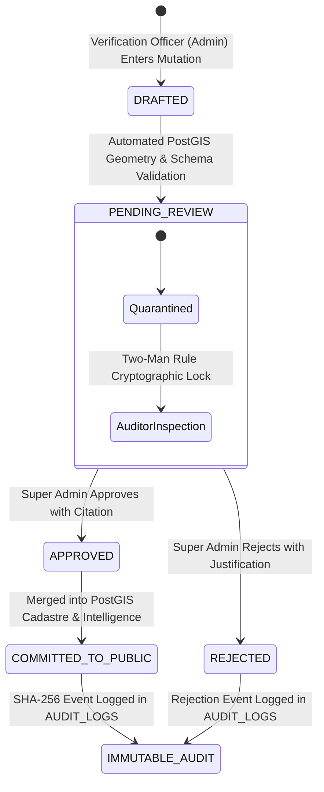

# LandGuard Two-Man Rule Governance & Verification Workflow

## 1. Statutory Context & Principles

In revenue land administration across India, fraudulent transfers, collusion, and unauthorized record modifications present severe financial and legal liabilities. To eliminate single-point administrator corruption or unilateral tampering, **LandGuard enforces an institutional Two-Man Rule (Maker-Checker architecture)** across all sensitive cadastral and intelligence operations.

Under **Section 4 and Section 9** of the LandGuard Charter:
- **Verification Officers (Role: ADMIN)** act strictly as **Makers**: they can draft new cadastral parcels, alter spatial boundaries, upload revenue deeds, and propose ownership mutations. They cannot approve their own submissions.
- **Platform Governors (Role: SUPER_ADMIN)** act as **Checkers**: they inspect proposed modifications against certified government records, evaluate diffs, and unilaterally authorize or reject mutations.

---

## 2. Maker-Checker State Machine

---

## 3. Quarantined Operations Subject to Two-Man Rule

| Entity | Operation | Maker (Admin) Action | Checker (Super Admin) Action |
|---|---|---|---|
| **Cadastral Boundary** | Realignment / Splitting / Vertex Update | `PUT /api/admin/properties/:id/boundary` | `POST /api/admin/change-requests/:id/review` (`APPROVE`) |
| **New Cadastre Parcel** | Initial Digitization & Survey | `POST /api/admin/properties` | `POST /api/admin/change-requests/:id/review` (`APPROVE`) |
| **Recorded Khatedar** | Title Transfer / Jamabandi Correction | `POST /api/admin/properties/:id/records` (`OWNERSHIP`) | Super Admin Review & Merge |
| **Legal Dispute** | e-Courts Injunction / Lis Pendens Notice | `POST /api/admin/properties/:id/records` (`LEGAL_DISPUTES`) | Super Admin Review & Merge |
| **Bank Encumbrance** | SRO Mortgage Registration / Lien | `POST /api/admin/properties/:id/records` (`ENCUMBRANCE`) | Super Admin Review & Merge |
| **Document OCR** | Tesseract Entity Commit | `PUT /api/documents/:id/verify-ocr` | `POST /api/documents/:id/commit` |

---

## 4. Cryptographic Audit Trail Specifications

Every mutation generates an immutable entry in `AUDIT_LOGS` with the following attributes:
- `id`: Globally unique identifier (`log-<timestamp>-<random>`)
- `admin_id`: Authenticated officer user ID
- `admin_name`: Full legal name of officer
- `admin_role`: Role at time of action (`ADMIN` or `SUPER_ADMIN`)
- `action`: Statutory action enum (e.g. `PROPOSE_OWNERSHIP_CHANGE`, `APPROVE_OWNERSHIP_CHANGE`)
- `target_entity`: Database entity name
- `target_id`: Affected property or document identifier
- `details`: JSON payload containing diff, citations, and court references
- `timestamp`: ISO 8601 UTC timestamp
