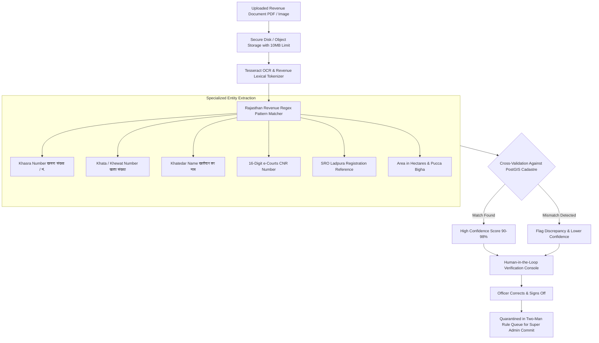

# LandGuard Document Storage & OCR Pipeline

## 1. Document Management Architecture

LandGuard provides a secure multi-format document dossier pipeline allowing verification officers to ingest statutory revenue documents, run optical character recognition (OCR), extract structured entities, conduct human-in-the-loop verification, and archive certified records.

Supported Statutory Document Types:
1. **Apna Khata (e-Dharti) Jamabandi Nakal (ROR)**: Record of Rights published by Board of Revenue Rajasthan.
2. **Registered Sale Deed (Bikray Patra)**: Conveyance deed registered with Inspector General of Registration and Stamps (IGRS Rajasthan), Sub-Registrar Office Ladpura, Kota.
3. **e-Courts Injunction / Status Quo Order**: Judicial orders issued under Order 39 Rules 1 & 2 CPC by Kota District Courts.
4. **Hereditary Mutation Extract (Virasat Intkal)**: Revenue court sanctioned mutation under Section 133 Rajasthan Land Revenue Act 1956.
5. **Bhunaksha Certified Field Sheet**: Official cadastral map extract from National Informatics Centre (NIC).

---

## 2. OCR Extraction Pipeline

---

## 3. Human-in-the-Loop Verification Console

As mandated by Section 10 of the LandGuard Charter, **no raw OCR extraction is ever published directly to public intelligence without human-in-the-loop review**.

The `AdminDocumentReviewModal` interface enables officers to:
1. Inspect the source document and confidence score.
2. Review extracted entities side-by-side with cadastral data.
3. Modify any misread characters (especially Devanagari Hindi numerics and complex honorifics).
4. Save corrections or submit for Super Admin two-man rule commit.
