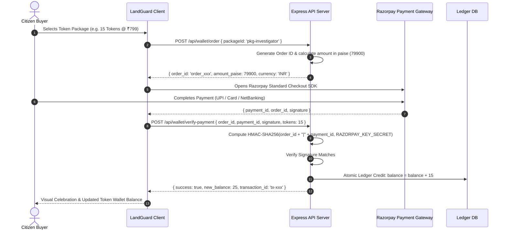

# LandGuard Token Monetization & Wallet System

## 1. Monetization Philosophy & Consumer Protection

LandGuard employs an investigative token monetization model. Rather than forcing users into expensive recurring subscriptions for a transaction that an ordinary citizen undertakes only once or twice in their lifetime, users purchase flexible token packages and spend them on targeted investigative checks.

### Zero Token Deduction Guarantee
**Under no circumstances are tokens deducted if the requested information category is absent or unverified.**
- If a user requests court cases on an unencumbered parcel with no disputes, the backend intercepts the request, verifies that no records exist, returns `DATA_UNAVAILABLE` with an informational notice, and **charges zero tokens**.
- If a user re-opens an intelligence tier previously unlocked, the unlock is idempotent and **charges zero tokens**.

---

## 2. Token Pricing Structure

| Category | Token Price | Description |
|---|---:|---|
| **Basic Cadastre Overview** | **FREE (0)** | Khasra number, boundary polygon, area in Bighas/Ha, village code |
| **Recorded Khatedari Title** | **1 Token** | Current owner name, parentage, tenure type, share fraction |
| **Government Land Check** | **1 Token** | Siway Chak, Charagah, RIICO, forest buffer alienation restrictions |
| **Legal Disputes Audit** | **2 Tokens** | Active civil suits, injunctions, Order 39 status quo orders |
| **e-Courts Case Details** | **2 Tokens** | 16-digit CNR number, court bench, petitioner/respondent, filings |
| **Bank Encumbrance & Mortgages**| **2 Tokens** | SRO registered mortgages, institutional liens, loan references |
| **Chain of Title History** | **2 Tokens** | Previous conveyances, registered sale deeds, consideration |
| **Complete Due Diligence Dossier**| **5 Tokens** | Comprehensive unlock bundle with official PDF Due Diligence Certificate |

---

## 3. Razorpay Payment & Webhook Architecture

